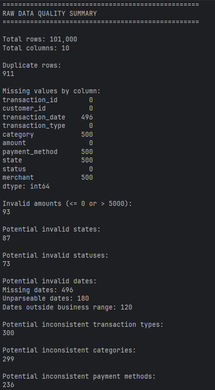
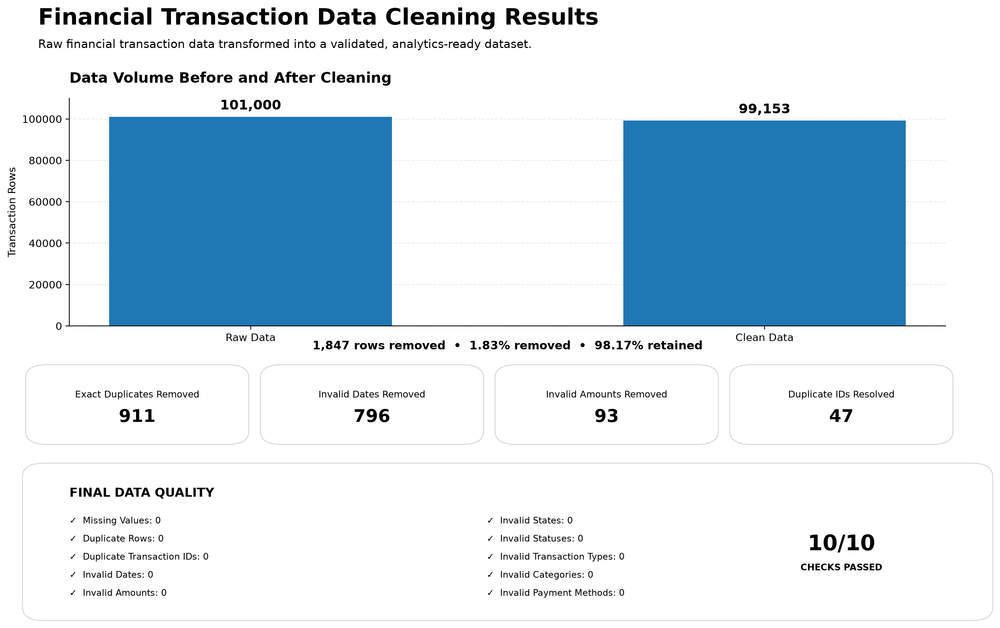
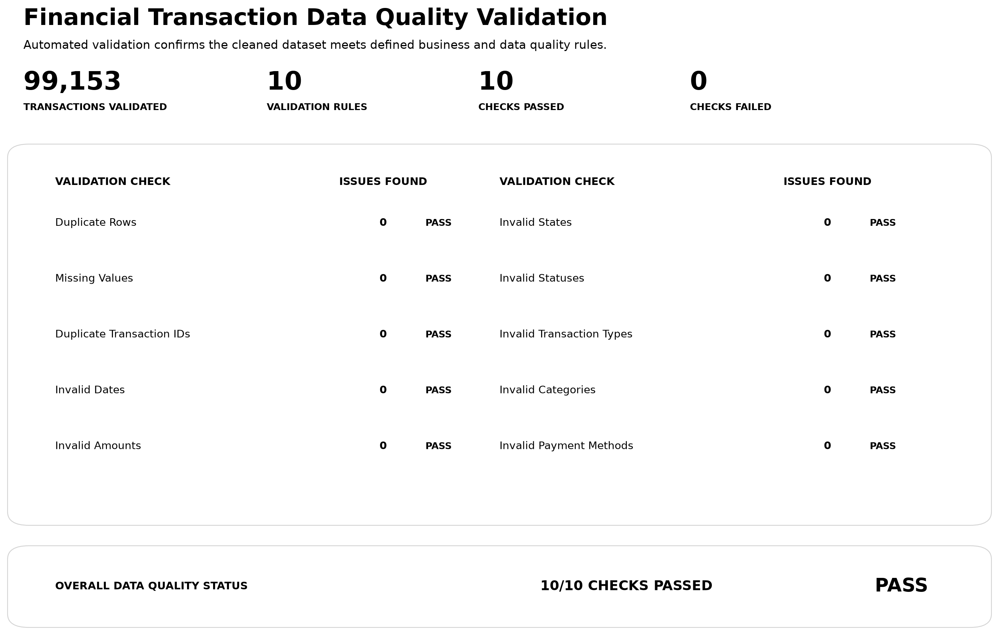
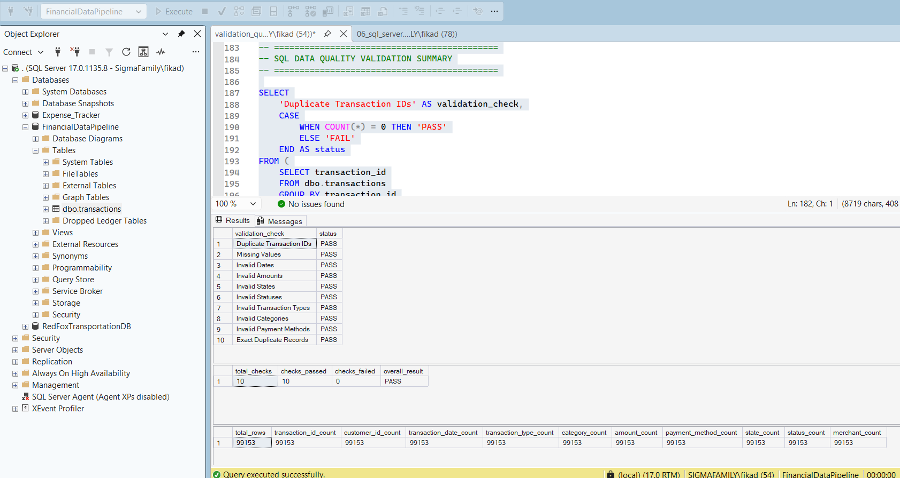
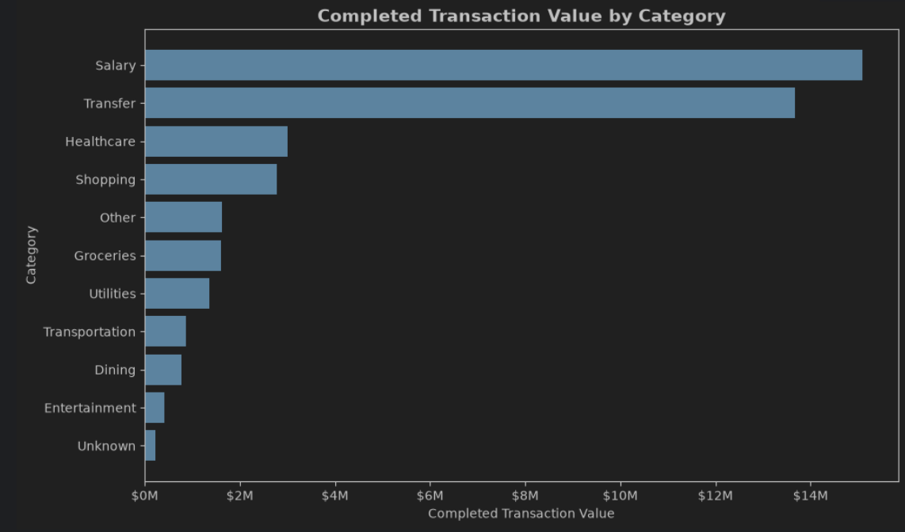
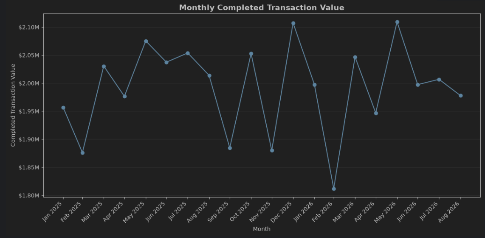
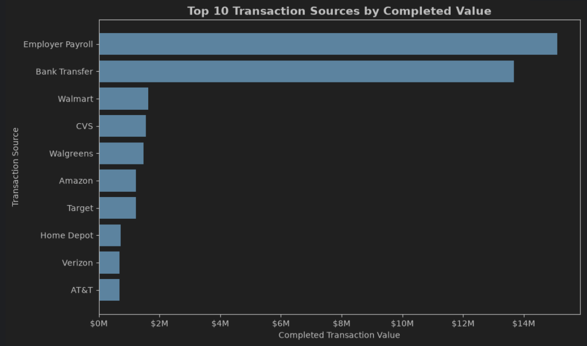
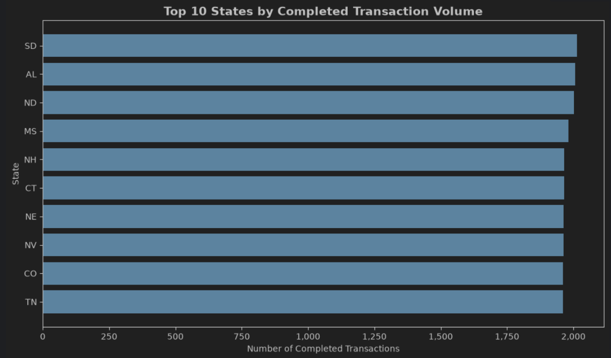

# Financial Transaction Data Cleaning Pipeline

## Project Overview

This project demonstrates an end-to-end financial transaction data cleaning, validation, SQL integration, and business analysis workflow.

A synthetic financial transaction dataset was created with realistic data-quality problems, including duplicate records, missing values, inconsistent text formatting, invalid dates, invalid transaction amounts, invalid state values, and inconsistent transaction statuses.

The project uses Python and Pandas to profile, clean, standardize, and validate the data before loading the analytics-ready dataset into SQL Server for additional validation. A Jupyter notebook then analyzes completed transaction activity across categories, transaction direction, time, transaction sources, and geography.

The project demonstrates how raw transactional data can be transformed into reliable, analytics-ready information for downstream reporting and business intelligence.

---

## Business Scenario

A financial services organization receives transaction data from multiple sources. Before the data can be used for business reporting and analytics, it must be assessed for quality, cleaned, standardized, and validated.

This project simulates that workflow from raw transaction data through data profiling, cleaning, validation, SQL Server integration, and business analysis.

## Project Objectives

The primary objectives of the project are to:

- Generate a realistic synthetic financial transaction dataset
- Profile raw data and identify data-quality issues
- Clean and standardize inconsistent transaction data using Python
- Apply business rules to identify and remediate invalid records
- Validate the cleaned dataset using automated Python checks
- Load analytics-ready transaction data into SQL Server
- Perform SQL-based data-quality validation
- Analyze cleaned transaction data using a Jupyter Notebook
- Distinguish overall transaction activity from completed financial activity
- Document the complete pipeline, validation results, and analytical findings

---

## Technology Stack

- **Python 3.11** — data generation, cleaning, transformation, and validation
- **Pandas** — data manipulation and analysis
- **NumPy** — synthetic data generation and numerical operations
- **Matplotlib** — analytical visualizations
- **Jupyter Notebook** — exploratory and business analysis
- **SQL Server** — relational data storage and SQL-based validation
- **SQLAlchemy** — Python-to-SQL Server database integration
- **PyODBC** — SQL Server connectivity
- **PyCharm** — development environment
- **Git & GitHub** — version control and project documentation

---

## Dataset

The project uses a synthetic financial transaction dataset generated specifically for this portfolio project.

The original dataset contains **100,000 generated transactions**. An additional **1,000 duplicate records** were introduced as part of the data-quality simulation, producing **101,000 raw rows**.

The dataset contains the following fields:

| Column | Description |
| --- | --- |
| `transaction_id` | Unique transaction identifier |
| `customer_id` | Customer identifier |
| `transaction_date` | Date of transaction |
| `transaction_type` | Credit or Debit transaction direction |
| `category` | Transaction category |
| `amount` | Gross transaction amount |
| `payment_method` | Payment method used |
| `state` | U.S. state associated with the transaction |
| `status` | Transaction processing status |
| `merchant` | Merchant or transaction source |

> **Note:** The dataset is synthetic. The patterns and analytical results in this project demonstrate data-engineering and analytical techniques and should not be interpreted as actual customer or financial behavior.

---

## Raw Data Quality Assessment

The raw dataset intentionally contains multiple types of data-quality problems commonly encountered in transactional systems.

Examples include:

- Exact duplicate records
- Duplicate transaction identifiers
- Missing categorical values
- Missing transaction dates
- Invalid and out-of-range dates
- Negative and zero transaction amounts
- Extremely large invalid transaction amounts
- Inconsistent capitalization
- Invalid state values
- Inconsistent transaction statuses

### Raw Data Quality Summary



Examples of the raw data-quality issues are also documented in:

- `screenshots/03_0_raw_data_quality_example.png`
- `screenshots/03_1_raw_data_quality_example.png`

---

## Pipeline Architecture

```text
Synthetic Transaction Data
          |
          v
   generate_data.py
          |
          v
 transactions_raw.csv
          |
          v
     clean_data.py
          |
          +----------------------+
          |                      |
          v                      v
 Data Cleaning              Data Validation
          |                      |
          +----------+-----------+
                     |
                     v
          transactions_clean.csv
                     |
             +-------+-------+
             |               |
             v               v
       SQL Server      Business Analysis
             |               |
             v               v
   SQL Validation    Jupyter Notebook
```

The architecture separates raw data generation, data preparation, database integration, validation, and analytical reporting while preserving reproducible project artifacts.

---

## Data Cleaning and Transformation

The Python cleaning pipeline performs a series of data-quality and transformation steps.

### Exact Duplicate Removal

Exact duplicate rows are identified and removed before downstream analysis.

### Text Standardization

Categorical fields such as:

- `transaction_type`
- `category`
- `payment_method`
- `state`
- `status`

are standardized to consistent values.

### Date Validation

Transaction dates are converted to valid datetime values and evaluated against the project's business date range.

Invalid, unparseable, missing, and out-of-range dates are excluded from the analytics-ready dataset.

### Amount Validation

Transactions with invalid amounts are removed.

Valid transaction amounts must be:

```text
amount > 0
amount <= 5000
```

### Missing-Value Remediation

Valid records with missing categorical information are retained where appropriate and standardized using the explicit value:

```text
Unknown
```

This avoids silently dropping otherwise valid transaction records.

### Duplicate Transaction ID Resolution

Duplicate transaction identifiers are investigated separately from exact duplicate rows.

Where duplicate IDs occur, the pipeline evaluates record completeness and retains the record containing the most usable information.

---

## Cleaning Results

The pipeline transformed **101,000 raw records** into **99,153 clean, validated transactions**.

| Metric | Result |
| --- | ---: |
| Raw rows | 101,000 |
| Final clean rows | 99,153 |
| Rows removed | 1,847 |
| Data retained | 98.17% |
| Exact duplicates removed | 911 |
| Invalid dates removed | 796 |
| Invalid amounts removed | 93 |
| Duplicate transaction IDs resolved | 47 |
| Final missing values | 0 |
| Final duplicate rows | 0 |
| Final duplicate transaction IDs | 0 |

### Cleaning Results



---

## Data Validation

The cleaned dataset is evaluated against **10 data-quality rules**.

Validation checks include:

1. Duplicate rows
2. Missing values
3. Duplicate transaction IDs
4. Invalid dates
5. Invalid transaction amounts
6. Invalid state values
7. Invalid transaction statuses
8. Invalid transaction types
9. Invalid categories
10. Invalid payment methods

The final dataset passed:

**10 / 10 validation checks**

with **zero identified issues**.



---

## SQL Server Integration

After Python cleaning and validation, the processed dataset is loaded into SQL Server using SQLAlchemy and PyODBC.

The SQL Server table uses `transaction_id` as the primary key and defines appropriate relational data types for each field.

SQL validation queries independently confirm:

- Total row count
- Duplicate-row status
- Duplicate transaction IDs
- Missing values
- Date validity
- Amount validity
- State validity
- Status validity
- Transaction-type validity
- Category validity
- Payment-method validity

The SQL Server table contains:

**99,153 validated transaction records**



---

## Business Analysis

The cleaned dataset is analyzed in:

```text
notebooks/01_business_analysis.ipynb
```

The notebook distinguishes between:

- **All valid transaction records**, which are useful for operational analysis
- **Completed transactions**, which are used when evaluating finalized transaction activity

It also distinguishes:

- **Gross transaction value (`amount`)**
- **Directional transaction value (`signed_amount`)**

Credits are represented as positive signed values and Debits as negative signed values for directional analysis.

---

## Completed Transaction Analysis

Approximately **93.98%** of valid transaction records have a `Completed` status.

Completed transactions are therefore used for analysis of finalized transaction activity while Pending, Failed, Reversed, and Unknown records remain preserved in the cleaned dataset.

### Completed Transaction Value by Category

Salary and Transfer account for the largest gross completed transaction values, while high-frequency categories such as Dining and Groceries contain substantially smaller average transaction amounts.



This demonstrates why transaction frequency and financial value should be evaluated separately.

---

## Monthly Transaction Trends

Monthly analysis uses complete calendar months from **January 2025 through August 2026**.

The dataset ends on September 25, 2026, so September 2026 is retained in the dataset but excluded from complete-month trend comparisons.

Gross completed transaction value generally remains between approximately **\$1.8 million and \$2.1 million per month**, without a strong sustained upward or downward trend.



Average daily transaction volume was also evaluated to account for differences in the number of calendar days across months.

---

## Transaction Source Analysis

The `merchant` field contains both traditional merchants and other transaction sources such as Employer Payroll and Bank Transfer.

For that reason, the analysis refers to these values collectively as **transaction sources**.

Employer Payroll and Bank Transfer account for the largest completed transaction values because their average transaction sizes are substantially larger than those associated with typical retail and service transactions.



This analysis demonstrates why source-level transaction frequency and source-level transaction value should be evaluated separately.

---

## Geographic Analysis

Completed transaction activity is distributed across a broad range of U.S. states.

The analysis distinguishes between:

- **Data validity** — whether state values contain recognized state codes
- **Geographic coverage** — whether every U.S. state is represented in the dataset

Completed transactions contain recognized state codes for **48 of the 50 U.S. states**.

The two states not represented are:

- Hawaii (`HI`)
- Montana (`MT`)

Transactions whose state could not be recovered during data cleaning remain explicitly classified as `Unknown`.



The leading states have relatively similar transaction volumes, indicating no strong geographic concentration within the synthetic dataset.

---

## Key Analytical Insights

Several important observations emerged from the analysis:

- **93.98% of valid transactions are Completed.**
- **Dining** generates the highest completed transaction frequency.
- **Salary** generates the highest gross completed transaction value at approximately **\$15.09 million**.
- Credit transactions occur much less frequently than Debit transactions but have substantially higher average transaction values.
- Completed Credit activity totals approximately **\$20.70 million**, compared with approximately **\$20.72 million** in completed Debit activity.
- Net signed completed transaction value is approximately **-\$11,641.61**.
- Completed Transfer activity produces approximately **-\$2.69 million** in net signed transaction value because outgoing Transfers exceed incoming Transfers.
- Monthly completed transaction activity remains relatively stable across the complete-month analysis period.
- Employer Payroll and Bank Transfer dominate completed transaction value at the transaction-source level.
- Valid state codes are represented across 48 U.S. states.

These findings demonstrate the importance of evaluating transaction frequency, gross value, processing status, and financial direction separately.

---

## Repository Structure

```text
FinancialDataCleaningPipeline/
|
├── data/
│   ├── raw/
│   │   └── transactions_raw.csv
│   └── processed/
│       └── transactions_clean.csv
|
├── notebooks/
│   └── 01_business_analysis.ipynb
|
├── screenshots/
│   ├── 01_raw_data_preview.png
│   ├── 02_raw_data_quality_summary.png
│   ├── 03_0_raw_data_quality_example.png
│   ├── 03_1_raw_data_quality_example.png
│   ├── 04_cleaning_results.png
│   ├── 05_validation_results.png
│   ├── 06_sql_server.png
│   ├── 07_completed_category_analysis.png
│   ├── 08_monthly_transaction_trends.png
│   ├── 09_transaction_source_analysis.png
│   └── 10_geographic_analysis.png
|
├── sql/
│   ├── create_tables.sql
│   └── validation_queries.sql
|
├── src/
│   ├── clean_data.py
│   ├── create_cleaning_results_visual.py
│   ├── create_validation_results_visual.py
│   ├── generate_data.py
│   └── load_data.py
|
├── .gitignore
├── README.md
└── requirements.txt
```

---

## How to Run the Project

### 1. Clone the repository

```bash
git clone <repository-url>
cd FinancialDataCleaningPipeline
```

### 2. Create a virtual environment

```bash
python -m venv .venv
```

### 3. Activate the virtual environment

Windows:

```bash
.venv\Scripts\activate
```

### 4. Install dependencies

```bash
pip install -r requirements.txt
```

### 5. Generate the raw dataset

```bash
python src/generate_data.py
```

### 6. Run the cleaning and validation pipeline

```bash
python src/clean_data.py
```

### 7. Create the SQL Server database and table

Run:

```text
sql/create_tables.sql
```

in SQL Server before loading the processed dataset.

### 8. Load the cleaned dataset into SQL Server

```bash
python src/load_data.py
```

> SQL Server connection settings in `load_data.py` may need to be updated for the local SQL Server environment.

> Before reloading the dataset into an existing table, clear or recreate the table to avoid duplicate primary-key conflicts.

### 9. Run SQL validation

Execute:

```text
sql/validation_queries.sql
```

### 10. Review the business analysis

Open:

```text
notebooks/01_business_analysis.ipynb
```

and run the notebook from top to bottom.

---

## Analytical Limitations

- The dataset is synthetic and does not represent actual customer or financial activity.
- Signed transaction values represent transaction direction, not profit, loss, account balance, or organizational cash flow.
- Reversed transactions cannot be reliably matched to corresponding original transactions because the synthetic dataset does not contain a reversal-linking identifier.
- `Unknown` values are intentional data-quality placeholders for information that could not be reliably recovered.
- September 2026 contains partial-month data and is excluded from complete-month trend comparisons.
- Geographic coverage does not include Hawaii or Montana.

---

## Skills Demonstrated

This project demonstrates practical experience with:

- Data profiling
- Data-quality assessment
- Data cleaning
- Data standardization
- Missing-value remediation
- Business-rule validation
- Duplicate detection and resolution
- Python and Pandas
- SQL Server integration
- SQL validation
- Relational data modeling
- Financial transaction analysis
- Time-series analysis
- Geographic analysis
- Matplotlib visualization
- Business interpretation
- Analytical documentation
- Reproducible project organization
- Git and GitHub

---

## Future Extensions

The cleaned and validated dataset can support additional business intelligence development, including:

- Power BI dashboards
- Tableau dashboards
- Interactive geographic visualizations
- KPI reporting
- Transaction monitoring
- Additional customer and payment-method analysis

These extensions can build on the validated dataset without changing the core cleaning pipeline.